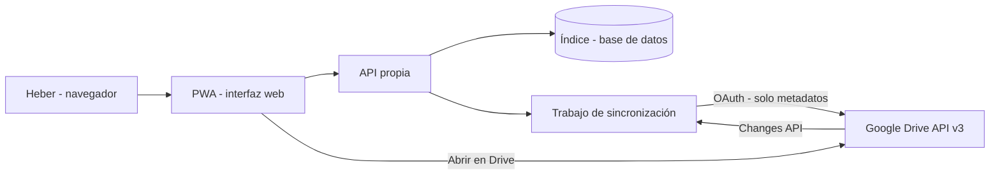

# Drive Organizer — Diseño del MVP y alcance

**Estado:** diseño v1 · 2026-11-12
**Autor:** Keysi, para Heber Romero Téllez
**Nombre de trabajo:** Drive Organizer (nombre definitivo por confirmar)

---

## 1. El problema, con datos reales

El Google Drive de Heber contiene hoy **29,056 elementos: 25,340 archivos y 3,716 carpetas**. Es al mismo tiempo su archivo laboral (Red Hat), su archivo personal y familiar, sus proyectos de estudio (BUAP) y el respaldo de dos décadas de recuerdos. La interfaz nativa de Drive no está pensada para administrar un volumen así:

- La búsqueda depende casi por completo del **nombre** del archivo.
- No hay forma de ver de un vistazo **qué está mal**: duplicados, archivos vacíos, nombres opacos, permisos riesgosos o archivos sin carpeta.
- Los cambios masivos son manuales, sin vista previa ni reversión.

Evidencia recogida el 2026-11-12, durante el proyecto de renombrado descriptivo:

| Hallazgo | Dato |
|---|---|
| Archivos renombrados a mano (con revisión de contenido) | 1,199 (94 documentos, 563 audios, 542 fotos) |
| Nombres que aún disparan patrones opacos (número solo, timestamp, `IMG…`, muy corto) | 393 |
| Archivos identificados que **no** se pudieron renombrar | 32 (permisos 403, contraseña, corrupción) |
| Archivos vacíos `TemporaryGeneratedFile_*` enviados a papelera | 587 (100% en 0 bytes) |
| Grupos de duplicados idénticos detectados en octubre 2026 | 3,738 grupos / 12,852 archivos |
| Artefactos de código/build que **no** deben renombrarse | ~876 (romperían referencias de proyectos) |
| Tipos dominantes | 4,942 PDF · 3,369 TXT · ~3,270 imágenes · 1,286 C# |

**Conclusión del diagnóstico:** el nombre solo no basta. Hace falta una capa de administración e inteligencia **encima** de Drive, no otro almacenamiento.

## 2. Propuesta

Una aplicación web personal que se conecta a Google Drive con la API oficial y construye un **índice propio** de metadatos. Sobre ese índice ofrece búsqueda, diagnóstico y vistas que Drive no tiene. Drive sigue siendo la fuente de verdad: la app no copia los archivos (en el MVP ni siquiera descarga su contenido).

### Principios de diseño

1. **Solo lectura en el MVP.** Ninguna acción escribe en Drive hasta que la fase 2 se apruebe por separado.
2. **Drive es la fuente de verdad.** El índice es una caché reconstruible; si se borra, se regenera.
3. **Nada irreversible, nunca.** Toda acción futura nace con historial y reversión.
4. **No romper proyectos.** Código, artefactos de build y carpetas de proyecto se marcan como *protegidos* y quedan fuera de cualquier automatización de nombres.
5. **Lo compartido no se toca.** Archivos de los que Heber no es dueño se reportan, no se modifican.
6. **Privacidad por diseño.** El MVP trabaja solo con metadatos (nombre, tipo, tamaño, fechas, dueño, permisos). El contenido solo se analiza en fases posteriores, archivo por archivo y con autorización expresa.

## 3. Alcance del MVP (v0.1)

### Dentro del alcance

1. **Conexión e indexación completa**
   - Inicio de sesión con Google (OAuth) con el alcance mínimo `drive.metadata.readonly`.
   - Indexación inicial de todos los elementos visibles (archivos, carpetas, unidades compartidas).
   - Sincronización incremental con la API de cambios (*Changes API*): altas, bajas, renombres y movimientos sin reescanear todo.
   - Estado de sincronización visible: última corrida, elementos indexados, errores.

2. **Panel principal (dashboard)**
   - Totales: archivos, carpetas, espacio por tipo, por carpeta raíz y por dueño.
   - Serie temporal: crecimiento por mes/año (fecha de creación).
   - **Índice de salud del Drive** (0–100) con su desglose (ver §5).
   - Accesos directos a los problemas detectados, ordenados por impacto.

3. **Explorador e inventario**
   - Tabla filtrable por tipo, carpeta, dueño, tamaño, fecha, estado de nombre y de permiso.
   - Búsqueda instantánea sobre el índice (nombre y ruta), con resaltado.
   - Vista de árbol de carpetas con conteos y tamaño agregado por rama.

4. **Diagnóstico de nombres**
   - Reglas de calidad de nombre (§4) con severidad y explicación por archivo.
   - Listas accionables: nombres opacos, muy cortos, solo fecha/número, genéricos (`scan`, `document`, `IMG…`), con sufijos de duplicado `-1/-2`.
   - Distinción automática entre *problema real* y *nombre técnico válido* (contexto de proyecto).

5. **Duplicados**
   - Agrupación por huella (`md5Checksum` cuando Drive la expone) + tamaño + tipo.
   - Para cada grupo: copias, rutas, espacio recuperable y copia «principal» sugerida (la de nombre más descriptivo).
   - Solo reporte: el MVP **no** borra ni mueve nada.

6. **Permisos y compartidos**
   - Archivos compartidos con enlace público, con dominios externos o con personas fuera de la cuenta.
   - Archivos de los que Heber no es dueño (con el dueño identificado) y archivos suyos en carpetas ajenas.
   - Archivos sin carpeta (huérfanos en la raíz lógica) y carpetas vacías.

7. **Detalle de archivo**
   - Ficha completa: ruta(s), tipo, tamaño, fechas, dueño, permisos, historial de nombres conocidos por el índice, diagnósticos que le aplican y enlace para abrirlo en Drive.

8. **Exportación**
   - Reporte del diagnóstico en CSV/Markdown: problema, archivo, ruta, severidad — el mismo formato de registro que ya usamos en el renombrado.

### Fuera del alcance del MVP (explícito)

- Renombrar, mover, borrar o compartir archivos (eso es **fase 2**, con aprobación y reversión).
- Descargar o analizar contenido: nada de OCR, lectura de PDF, EXIF avanzado ni transcripción de audios (eso es **fase 3**).
- Colecciones virtuales y etiquetas propias (fase 2; el modelo de datos ya las prevé).
- Reglas automáticas sobre archivos nuevos (fase 4).
- Multiusuario: la app es personal, para la cuenta de Heber.
- Sustituir a Drive: sin almacenamiento propio de archivos, sin sincronización de escritorio, sin editores.

## 4. Reglas de diagnóstico de nombres (v1)

| Regla | Ejemplo | Severidad | Notas |
|---|---|---|---|
| Solo números o símbolos | `3200755497.pdf` | Alta | Salvo contexto técnico conocido |
| Marca de tiempo pura | `202202110719231026.jpg` | Alta | La fecha va como metadato, no como nombre |
| Nombre de cámara/app | `IMG_4506.HEIC`, `DSC02373.JPG` | Alta | Si no trae sufijo descriptivo |
| Genérico de escáner | `scan0033.pdf`, `document (2).pdf` | Media | Muy común en digitalizaciones |
| Sin título | `Untitled`, `Documento sin título` | Media | Frecuente en Google Docs |
| Muy corto (≤4 caracteres) | `P2.jpg`, `a.js` | Baja | A menudo válido en código; depende del contexto |
| Sufijo de duplicado | `nombre-1`, `nombre-2` | Informativa | Heredado de la limpieza de duplicados |
| Hash/UUID | `ba499a19-….pdf` | Alta | Sin contexto que lo justifique |
| Archivo en 0 bytes | `TemporaryGeneratedFile_…` | Alta | Candidato a papelera (con aprobación) |
| Extensión engañosa | `.3ds` clasificado como imagen | Media | Drive/Google a veces etiquetan mal el tipo |

Cada regla puede silenciarse por carpeta o por patrón (p. ej. «en proyectos de código, nombres cortos no son problema»).

## 5. Índice de salud del Drive

Puntuación 0–100, calculada solo con señales del índice:

- **Nombres claros** (30 pts): % de archivos sin diagnósticos de nombre de severidad alta/media.
- **Sin duplicados innecesarios** (25 pts): penaliza por espacio duplicado sobre espacio total.
- **Ubicación** (20 pts): % de archivos dentro de una carpeta con propósito (no huérfanos, no en raíz).
- **Permisos sanos** (15 pts): penaliza enlaces públicos y compartidos externos olvidados.
- **Sin basura técnica** (10 pts): archivos en 0 bytes, temporales y restos de build fuera de proyecto.

El índice **no** castiga decisiones legítimas: carpetas protegidas y archivos técnicos quedan fuera del denominador cuando la regla está silenciada en su contexto.

## 6. Arquitectura

- **Interfaz:** aplicación web instalable (PWA), en español, pensada primero para escritorio y consultable desde el móvil.
- **API y sincronización:** servicio pequeño (contenedor) que habla con Drive API, mantiene el índice y expone consultas rápidas. La búsqueda se hace sobre el índice local, nunca contra Drive en vivo.
- **Datos:** una fila por elemento de Drive + tablas de diagnósticos, grupos de duplicados y eventos de sincronización. Sin contenido de archivos.
- **Autenticación:** OAuth de Google; en el MVP, alcance `drive.metadata.readonly`. Cada fase que pida más poder pedirá su propio alcance, por separado.

### Modelo de datos mínimo

`items(id, name, mime_type, size, parent_ids, path_cache, owner, created_at, modified_at, md5, shared_flags, trashed, protected_context)`
`diagnostics(item_id, rule, severity, detail, first_seen, status)`
`duplicate_groups(id, md5, size, copies, reclaimable_bytes)`
`sync_state(cursor, last_run, items_indexed, errors)`

## 7. Flujos clave

1. **Primera conexión:** Heber autoriza → indexación completa (≈29 mil elementos; con paginación de la API, minutos) → el panel muestra el diagnóstico inicial.
2. **Uso diario:** abrir la app → ver salud y novedades desde la última visita → filtrar un problema → revisar la lista → abrir en Drive lo que quiera resolver a mano.
3. **Sincronización:** automática por cambios (Changes API) + reconciliación completa programada para cazar cualquier deriva.

## 8. Seguridad y privacidad

- Tokens OAuth cifrados en reposo; nunca en el repositorio ni en registros.
- El índice contiene **metadatos sensibles en agregado** (nombres y rutas): se trata como dato personal, con acceso solo para Heber.
- Sin telemetría de terceros en el MVP.
- Registro de auditoría de la propia app: qué se indexó, cuándo y qué errores hubo.
- Botón de **desconexión total**: revoca el acceso y borra el índice.

## 9. Criterios de aceptación del MVP

1. Indexa ≥ 99.9% de los elementos visibles de la cuenta y lo demuestra contra un listado independiente.
2. La sincronización incremental refleja un renombre/movimiento hecho en Drive en menos de 5 minutos.
3. El panel reproduce las cifras conocidas: 25,340 archivos / 3,716 carpetas (± deriva natural), 1,199 renombrados detectables por su formato, 587 archivos en 0 bytes ya en papelera (no deben aparecer como problema activo).
4. El diagnóstico de nombres encuentra los 32 archivos bloqueados conocidos y no marca como problema los artefactos de proyecto protegidos de la muestra de control.
5. Los grupos de duplicados por huella coinciden con una muestra verificada a mano (precisión del 100% en la muestra; la huella manda, no el nombre).
6. Ninguna operación del MVP escribe en Drive: verificable en el registro de actividad de la cuenta.
7. Búsqueda sobre el índice con respuesta < 300 ms en la vista principal.

## 10. Ruta posterior (fuera del MVP)

- **Fase 2 — Acciones reversibles:** renombrar y mover con vista previa, aprobación por lotes, historial y deshacer; colecciones virtuales y etiquetas sin mover archivos. Alcance OAuth adicional, pedido aparte.
- **Fase 3 — Inteligencia de contenido:** OCR de imágenes/PDF escaneados, EXIF real de fotos, transcripción de audios, resúmenes y clasificación por tema/persona/proyecto. Procesamiento selectivo, nunca masivo sin autorización.
- **Fase 4 — Automatización:** reglas para archivos nuevos («todo PTT que entre se propone renombrar así»), reporte semanal de salud y alertas de permisos.

## 11. Decisiones abiertas (de Heber)

1. **Nombre** del producto y del repositorio (propuesta de trabajo: *Drive Organizer*).
2. **Alojamiento**: servicio en la nube con su cuenta (p. ej. Cloud Run + base gestionada) frente a ejecutarlo en infraestructura propia.
3. **Idioma de la interfaz**: español (propuesto) o bilingüe como su sitio personal.
4. Si el diseño y el código vivirán en un repo **privado** (propuesto: privado, el índice describe su archivo personal).

## 12. Orden de construcción propuesto

1. Esqueleto: autenticación OAuth + indexación completa + estado de sincronización.
2. Explorador con búsqueda y filtros sobre el índice.
3. Motor de reglas de nombres + panel de salud.
4. Duplicados por huella + reporte de permisos.
5. Detalle de archivo, exportación de reportes y endurecimiento (auditoría, desconexión total).
6. Verificación contra los criterios de aceptación (§9) con los datos reales de la cuenta.
